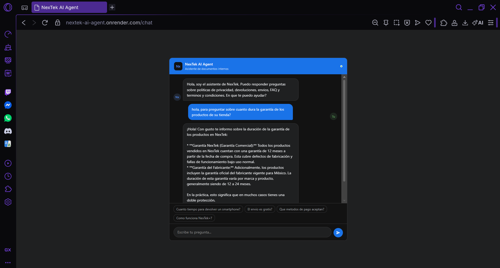

# NexTek AI Agent

Agente conversacional de atención al cliente para **NexTek México**, una tienda de tecnología ficticia. Responde en lenguaje natural preguntas sobre las políticas de la empresa (devoluciones, envíos, privacidad, términos y condiciones y preguntas frecuentes) e indica de qué documento y página sale cada respuesta.

**Demo en producción:** https://nextek-ai-agent.onrender.com

> El servicio está en el plan gratuito de Render: si estuvo inactivo, la primera petición puede tardar cerca de un minuto en responder (cold start).



---

## Cómo funciona

El proyecto usa el patrón **RAG (Retrieval-Augmented Generation)**: en lugar de que el modelo responda de memoria, primero se recuperan los fragmentos relevantes de los documentos oficiales y el modelo responde usando solo ese contexto.

### 1. Indexación (offline, una sola vez)

```
5 PDF de políticas
   │  PyPDFLoader: extrae el texto página por página
   ▼
RecursiveCharacterTextSplitter: divide el texto en fragmentos con solapamiento
   │
   ▼
gemini-embedding-001: convierte cada fragmento en un vector de 3072 dimensiones
   │
   ▼
FAISS: guarda los vectores en nextek_index/ (71 fragmentos)
```

El índice ya construido se incluye en el repositorio, así que el servidor no necesita los PDF ni genera embeddings de los documentos al arrancar. Los PDF no se publican.

### 2. Consulta (en cada pregunta)

```
Navegador (widget JS)
   │  POST /preguntar  {"pregunta": "..."}
   ▼
FastAPI · responder()
   1. Valida la pregunta (vacía → HTTP 400)
   2. Genera el embedding de la pregunta y busca en FAISS los 2 fragmentos más cercanos
   3. Filtra por relevancia: conserva los fragmentos con distancia ≤ 0.70
   4a. Hay contexto → prompt con contexto | Gemini | StrOutputParser + lista de fuentes
   4b. No hay contexto → prompt general (saludo o redirección cordial, sin inventar políticas)
   ▼
{"respuesta": "...", "sources": ["<documento>.pdf - pag. N"]}
```

Los vectores del índice están normalizados, así que la distancia L2 al cuadrado que devuelve FAISS equivale a `2 · (1 − similitud coseno)`. El umbral de 0.70 corresponde a una similitud coseno mínima de 0.65.

---

## Stack tecnológico

| Capa | Tecnología |
|---|---|
| Lenguaje | Python 3.11 |
| API | FastAPI + Uvicorn |
| Orquestación RAG | LangChain (`langchain-core`, `langchain-community`, `langchain-google-genai`) con LCEL |
| Embeddings | Google `models/gemini-embedding-001` (3072 dimensiones) |
| Modelo de lenguaje | Google Gemini (configurable con `LLM_MODEL`) |
| Base vectorial | FAISS (`faiss-cpu`, índice plano L2) |
| Validación | Pydantic |
| Frontend | HTML, CSS y JavaScript sin frameworks |
| Despliegue | Docker en Render |

---

## Estructura del proyecto

```
nextek-ai-agent/
├── app.py                  # API FastAPI: carga del índice, endpoints y lógica RAG
├── index.html              # Página de demostración con las tres vistas del widget
├── assets/
│   ├── nextek-widget.js    # Widget de chat incrustable (sin frameworks)
│   ├── nextek-widget.css   # Estilos del widget y de sus tres modos
│   └── demo.png            # Captura de la aplicación en producción
├── nextek_index/
│   ├── index.faiss         # Vectores (71 × 3072)
│   └── index.pkl           # Texto y metadatos de cada fragmento (documento y página)
├── nextek_agente.ipynb     # Prototipo inicial en Google Colab
├── Dockerfile              # Imagen de producción (python:3.11-slim)
├── requirements.txt        # Dependencias de Python
├── iniciar.bat             # Lanzador para Windows (activa venv y ejecuta app.py)
└── .gitignore
```

---

## API

| Método | Ruta | Descripción |
|---|---|---|
| `GET` | `/` o `/index.html` | Sirve la página de demostración |
| `GET` | `/estado` | Estado del servicio |
| `POST` | `/preguntar` | Responde una pregunta |
| `GET` | `/docs` | Documentación interactiva generada por FastAPI |

**`GET /estado`**

```json
{ "status": "ready", "modelo": "gemini-2.5-flash", "fragmentos": 71 }
```

`status` vale `"no_index"` si no se encontró `nextek_index/index.faiss`.

**`POST /preguntar`**

```bash
curl -X POST https://nextek-ai-agent.onrender.com/preguntar \
  -H "Content-Type: application/json" \
  -d '{"pregunta": "¿El envío es gratis?"}'
```

```json
{
  "respuesta": "…",
  "sources": ["/content/docs/04_NexTek_Guia_Envios_Entregas.pdf - pag. 3"]
}
```

- Pregunta vacía → `400` con `{"detail": "La pregunta no puede estar vacía."}`.
- Campo `pregunta` ausente → `422` (validación de Pydantic).
- Errores internos o índice no disponible → `200` con un mensaje que empieza por `⚠️` y `sources` vacío, para que el widget siempre pueda mostrar una respuesta.

---

## Widget de chat

`assets/nextek-widget.js` expone `window.NexTekWidget` con dos métodos: `init(opciones)` y `destroy()`. Tiene tres modos:

| Modo | Comportamiento |
|---|---|
| `fab` | Botón flotante que abre un panel; se puede arrastrar desde la cabecera |
| `fullscreen` | Chat integrado dentro de un contenedor de la página (`target`) |
| `messenger` | Chat anclado abajo a la derecha que se minimiza pulsando la cabecera |

Incluye cuatro preguntas sugeridas, indicador de escritura, etiquetas con las fuentes y diseño responsivo (pantalla completa en pantallas de 600 px o menos).

**Inicialización desde JavaScript** (como en `index.html`):

```html
<script src="/assets/nextek-widget.js"></script>
<script>
  NexTekWidget.init({ mode: "fab", color: "#2563eb" });
  // NexTekWidget.init({ mode: "fullscreen", target: "chat-target-box" });
  // NexTekWidget.init({ mode: "messenger", color: "#0084ff" });
</script>
```

**Inicialización automática con atributos** (se inicia sola si existe `data-mode`):

```html
<script src="https://nextek-ai-agent.onrender.com/assets/nextek-widget.js"
        data-api="https://nextek-ai-agent.onrender.com"
        data-mode="messenger"
        data-color="#0084ff"></script>
```

Opciones disponibles: `api` / `data-api` (URL base del backend; vacío = mismo dominio), `mode` / `data-mode`, `target` / `data-target` y `color` / `data-color`. También acepta los alias `inline` (= `fullscreen`) y `floating` (= `fab`).

---

## Ejecución local

**Requisitos:** Python 3.11 y una API key de Google Gemini ([Google AI Studio](https://aistudio.google.com/app/apikey)).

```bash
git clone https://github.com/ricardo2175539412a-cpu/nextek-ai-agent.git
cd nextek-ai-agent

python -m venv venv
# Windows:     venv\Scripts\activate
# Mac/Linux:   source venv/bin/activate

pip install -r requirements.txt
```

Crea un archivo `.env` en la raíz:

```env
GOOGLE_API_KEY=tu_api_key
LLM_MODEL=gemini-2.5-flash
```

Inicia el servidor con cualquiera de estas opciones:

```bash
python app.py                    # abre el navegador en http://127.0.0.1:8000
uvicorn app:app --reload         # modo desarrollo
iniciar.bat                      # Windows, con el venv ya creado
```

### Variables de entorno

| Variable | Obligatoria | Por defecto | Uso |
|---|---|---|---|
| `GOOGLE_API_KEY` | Sí | — | Embeddings y modelo de Gemini. Sin ella la app no arranca |
| `LLM_MODEL` | No | `gemini-3.1-flash-lite` | Modelo de chat (en producción: `gemini-2.5-flash`) |
| `INDEX_DIR` | No | `./nextek_index` | Carpeta del índice FAISS |

### Parámetros del RAG (en `app.py`)

| Parámetro | Valor |
|---|---|
| Fragmentos recuperados (`k`) | 2 |
| Umbral de relevancia (distancia L2²) | 0.70 |
| `temperature` | 0.1 |
| `max_output_tokens` | 350 |

---

## Docker y despliegue

```bash
docker build -t nextek-ai-agent .
docker run -p 8000:8000 -e GOOGLE_API_KEY=tu_api_key -e LLM_MODEL=gemini-2.5-flash nextek-ai-agent
```

En Render, el servicio se construye a partir del `Dockerfile` del repositorio y las variables `GOOGLE_API_KEY` y `LLM_MODEL` se definen en el panel del servicio.

---

## Sobre el notebook

`nextek_agente.ipynb` es el **prototipo inicial** hecho en Google Colab (carga de PDF, *chunking*, índice FAISS y un agente con `RetrievalQA`). Algunos de sus parámetros (`models/embedding-001`, `chunk_size=1000`, `k=5`, `temperature=0.2`, `gemini-1.5-flash`) son de esa primera versión. El índice publicado en `nextek_index/` se generó después con `gemini-embedding-001` (3072 dimensiones), que es el modelo que usa `app.py`. Cambiar el modelo de embeddings obliga a regenerar el índice.

---

## Limitaciones conocidas y próximos pasos

- **Fuentes con ruta de Colab:** las etiquetas muestran el prefijo `/content/docs/` porque así quedó en los metadatos del índice.
- **Respuestas cortadas:** con `max_output_tokens=350`, los modelos con razonamiento (como `gemini-2.5-flash`) pueden truncar la respuesta, porque los tokens de razonamiento también cuentan.
- **Cuota gratuita de Gemini:** al agotarse, las peticiones fallan.
- **Markdown sin formato:** el widget muestra la respuesta con `textContent`, así que el Markdown aparece como texto plano.
- **Sin memoria de conversación:** cada pregunta se procesa de forma independiente.
- **Widget en sitios externos:** el CSS se inyecta con la ruta relativa `/assets/nextek-widget.css`; incrustado en otro dominio hay que enlazar el CSS manualmente con la URL completa.
- **Dependencias sin versión fija** en `requirements.txt`.
- **CORS abierto** (`allow_origins=["*"]`) para permitir incrustar el widget; en producción real convendría limitarlo a dominios conocidos.
- **Deserialización del índice:** se usa `allow_dangerous_deserialization=True` porque `index.pkl` es un pickle generado por el propio equipo; nunca debe cargarse un índice de origen desconocido.

Ideas de mejora: fijar versiones, quitar el prefijo de las fuentes, renderizar Markdown de forma segura, respuestas en *streaming*, memoria de conversación, caché, *re-ranking* o búsqueda híbrida, evaluación de calidad del RAG, pruebas automatizadas y CI/CD.

---

*Proyecto final del Challenge de Implementación de Inteligencia Artificial.*
*Stack: Python · FastAPI · LangChain · Google Gemini · FAISS · Docker · Render*
